<p align="center">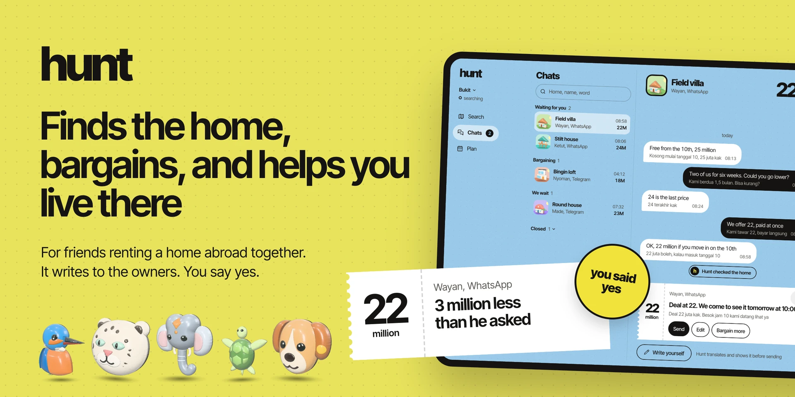</p>

<p align="center">
  <b>English</b> · <a href="README.ru.md">Русский</a>
</p>

<p align="center">
  
  
  
  
  
  
</p>

Renting abroad with friends is a second job: forty chats, three languages, a price that depends on who asks, and then somebody has to buy the power token.

**Hunt is a personal assistant for that job.** It finds homes, writes to owners from your own accounts and in their language, bargains, plans viewings, reads the lease. Your group votes and says yes. After move-in the same project runs the house: money, orders, what is on tonight, documents.

<p align="center">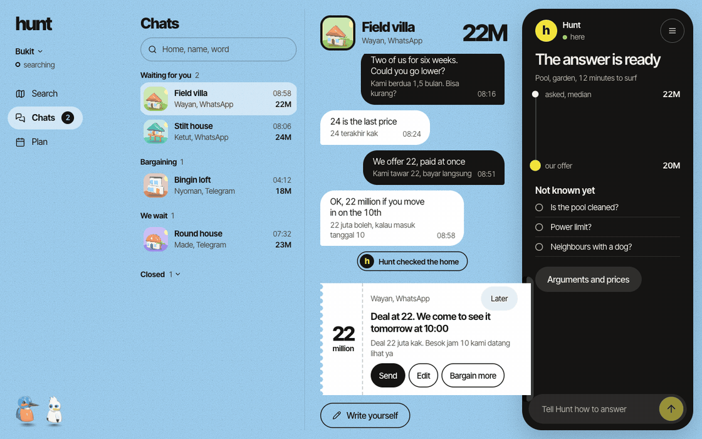</p>

## What it does

The pictures are two invented projects: a search for a flat in Belgrade and a rented house on Bali.

<p align="center">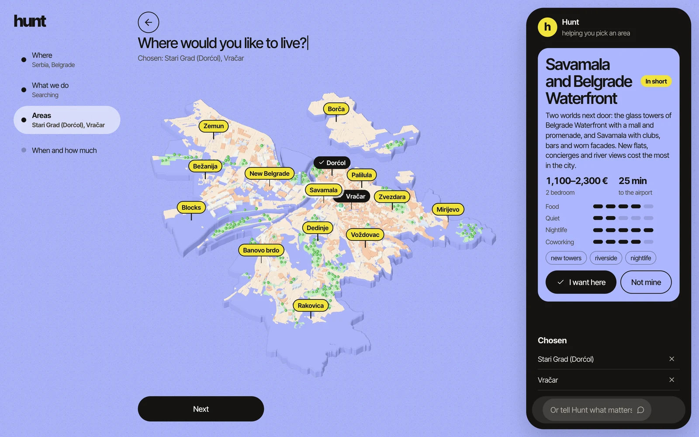</p>

**Starts from the map.** Pick a country and a city, then tap the areas on a toy map of it. Each has a short card: the area in two sentences, the price for your bedrooms, minutes to the airport, four scores, *I want here* or *Not mine*. Then the move-in date, the term and a price cap that only you see. Writing it to Hunt in your own words works the same.

<table>
<tr>
<td width="50%" valign="top">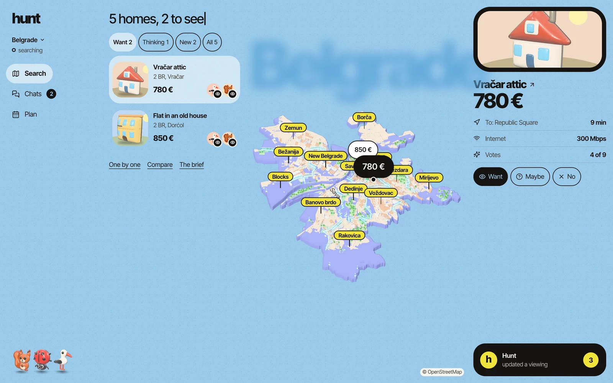<br><b>Finds.</b> Portals, chats and groups you point it to, homes as pins on a toy map of the real city. Checks scams, floods, the road to the beach or the metro. Your friends vote, the best ones rise.</td>
<td width="50%" valign="top">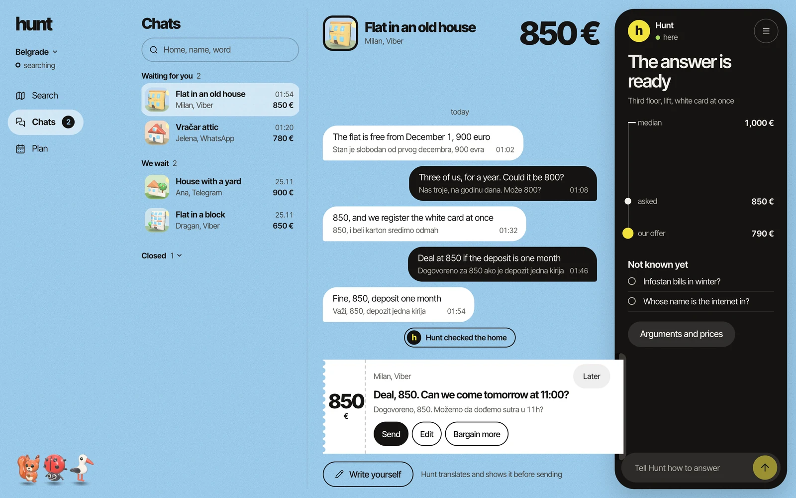<br><b>Writes and bargains.</b> Telegram, WhatsApp, Messenger, Instagram, e-mail; Viber and LINE by one tap. You read your language first, the original is under it. Your limit stays private.</td>
</tr>
<tr>
<td width="50%" valign="top">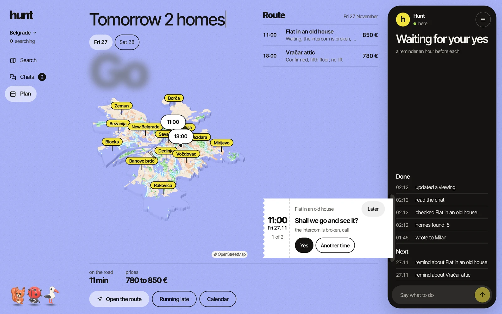<br><b>Plans.</b> Viewings on one route, a reminder before each home, one ticket to confirm.</td>
<td width="50%" valign="top">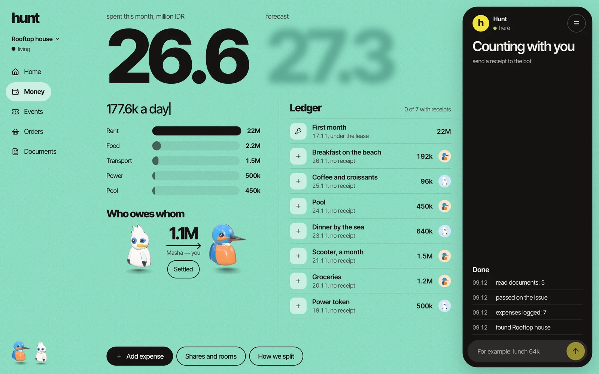<br><b>Counts.</b> Who paid, who owes whom, how much a day costs. A blurred number is still open, a sharp one is decided.</td>
</tr>
<tr>
<td width="50%" valign="top">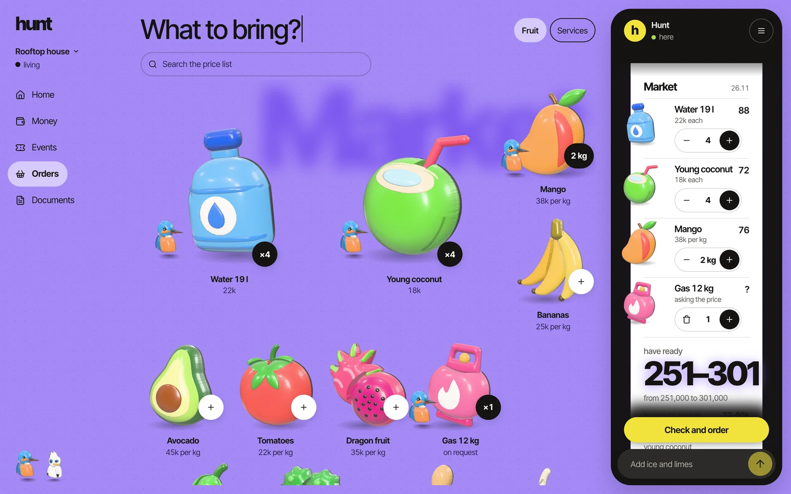<br><b>Brings.</b> Water, fruit, fish: a price list becomes a counter, the receipt prints while you pick.</td>
<td width="50%" valign="top">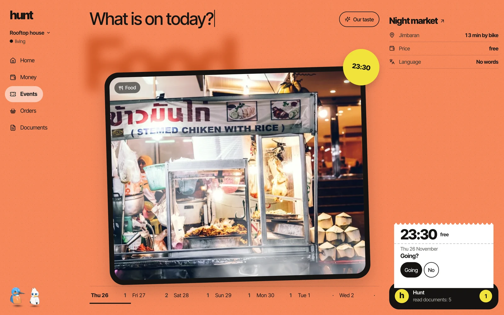<br><b>Knows what is on.</b> Events near your home, why they suit you, and it books you in.</td>
</tr>
<tr>
<td width="50%" valign="top">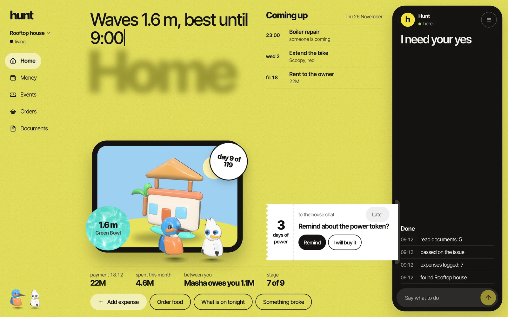<br><b>Gathers it all.</b> What is next, what waits for your yes, how the waves are.</td>
<td width="50%" valign="top">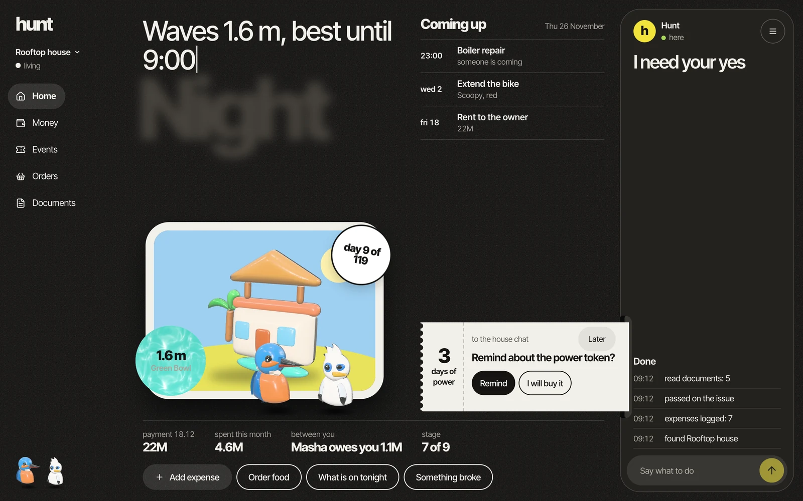<br><b>Looks after the house.</b> Power, repairs, guests, the lease end. It asks when your yes is needed and is quiet otherwise.</td>
</tr>
</table>

The same app is a Telegram Mini App on the phone:

<p align="center">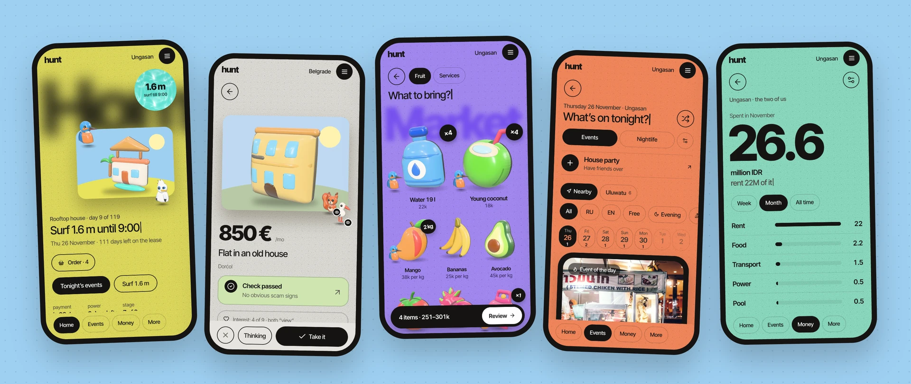</p>

## How it works

<p align="center">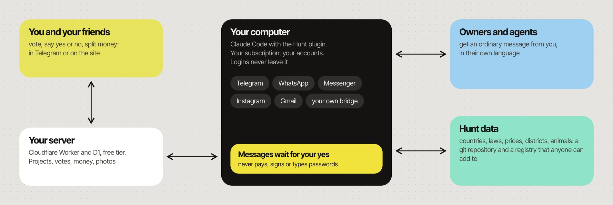</p>

- **Your agent, your subscription, your accounts.** Claude Code runs on your computer with the Hunt plugin. Logins stay there; the server never has them.
- **You decide.** A message waits for your yes, then eight more seconds for an undo. Routine ones can go by themselves if you turn it on. The agent never pays, signs, or types passwords and codes.
- **Several people, one server.** Friends bring their own agents. Nobody sees another's projects, contacts or chats.
- **In a browser without passwords.** The site shows a number, you press it in the bot.

## Try it

**Look first.** Any Hunt server has a demo without sign-in: invented people, toy homes, nothing is sent. Open `/app` and press *See the demo*. On your machine:

```bash
git clone https://github.com/LevDomasnih/hunt && git clone https://github.com/LevDomasnih/hunt-data
cd hunt/crm && npm ci && npm run dev
```

The app finds `hunt-data` next to `hunt` by itself; `HUNT_REGIONS=<path>/regions` points elsewhere.

**A friend has a server.** Open their invite link, press Start in the bot, then in Claude Code ([uv](https://docs.astral.sh/uv/) is needed):

```
/plugin marketplace add LevDomasnih/hunt
/plugin install hunt@hunt
/hunt:new Tbilisi
```

**In Codex** instead of Claude Code: `codex plugin marketplace add LevDomasnih/hunt`, then `codex plugin add hunt@hunt` (or `/plugins` in the TUI). Commands become skills: `$hunt:new Tbilisi`. More in [CODEX.md](plugins/hunt/docs/CODEX.md).

**Your own server.** About ten minutes on Cloudflare's free tier: [crm/README.md](crm/README.md).

## Commands

| Command | |
|---|---|
| `/hunt:new <place>` | a new search: brief, region, friends |
| `/hunt:connect` | connect Telegram, WhatsApp, Messenger, Instagram, e-mail |
| `/hunt:sweep` | collect new listings |
| `/hunt:tick` | what is new: votes, replies, approvals, drafts |
| `/hunt:deal` | lease check, payments, move-in |
| `/hunt:region <place>` | prepare a country or a city nobody has made yet |
| `/hunt:share <country>` | offer it to everyone |
| `/hunt:schedule`, `/hunt:close` | run by itself; finish politely |

## Every place has its own face

A country is data: laws with sources, prices, districts with a short card each, scams, message templates, the main forums and guides in English, Russian and the local language, and a look. One bright colour, eight animals that live there. Each friend gets an animal.

<p align="center">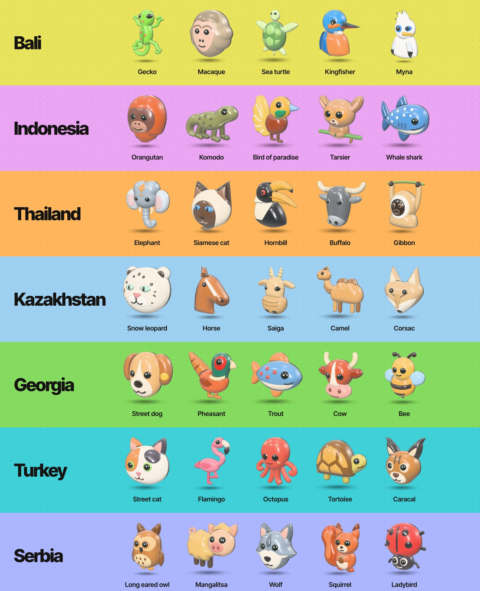</p>

Ready now:

| Country | Cities |
|---|---|
| Bali | Bukit, Canggu, Ubud, Sanur |
| Indonesia | Jakarta |
| Thailand | Bangkok, Phuket, Pattaya, Chiang Mai, Koh Phangan |
| Kazakhstan | Almaty, Astana |
| Georgia | Tbilisi, Batumi |
| Turkey | Istanbul, Antalya |
| Serbia | Belgrade, Novi Sad |

Big cities get a toy map made from OpenStreetMap: blocks cut by the real streets and raised by their buildings, parks with toy trees, rivers, a few landmarks, yellow signs for the areas and soft light walls between them. Every city above has one.

The skill `hunt-art` teaches any agent to draw a new place in this style: flat shapes become glossy toys, a script checks the colours and the shapes; `citymap.py` builds the city.

**Your city is missing?** `/hunt:region Lisbon` drafts it. `/hunt:share pt` offers it to everyone: the bot shows you the whole text that would go, and nothing is sent without your yes. The admin reviews it, then everybody has it. Data lives apart from the code: [hunt-data](https://github.com/LevDomasnih/hunt-data) for laws, districts and art, a registry (`registry/`) for chats and groups.

## Channels

| Channel | How |
|---|---|
| Telegram | your account over MTProto, login by QR; or Telegram's chat automation, where Hunt sees only the chats you open and Telegram enforces it |
| WhatsApp | WhatsApp Web in Hunt's own browser profile, login by QR |
| Messenger, Instagram | Hunt's own browser profiles; you log in yourself |
| E-mail | the Gmail connector |
| Viber, LINE | Hunt prepares the text and a link; the chat opens in your own app and you press send |
| anything else | a **bridge**: a small local HTTP service, see [BRIDGE.md](plugins/hunt/channels/BRIDGE.md). Signal or a local portal need no change in Hunt |

> [!WARNING]
> WhatsApp, Messenger and Instagram forbid automating personal accounts and may ban them. Connecting them is optional and your own decision. Use a separate number if you can, keep the pace low, and read and write in group chats only where their rules allow it. Telegram limits accounts for spam.

## Privacy

Logins, sessions and the agent stay on your computer. The server keeps projects, votes, money and the messages your agent logged; passport and card numbers are refused. What Hunt may read is a screen, not a promise: which chats are open, what stays closed, how much it may spend on AI, and one button that takes it all back and prints what it closed. Whoever runs the server can technically open its database, so use your own or a friend's you trust. `/privacy` in the bot says what is stored, `/delete` removes you with all your projects. Your agent thinks on your subscription: texts go to your model's provider.

## Please check

Rental, immigration and brokerage rules differ by country. In Indonesia acting for other people in property deals is restricted for foreigners. Region notes are general information with sources and dates, not legal advice. Use Hunt for your own home, and ask a local professional about the contract and the right to rent out.

## What is inside

| Path | What |
|---|---|
| `plugins/hunt/` | the Claude Code plugin: skills, commands, MCP servers, channels |
| `crm/` | Cloudflare Worker: API, Telegram bot, site; the Mini App is TypeScript in `crm/web/` (Preact + htm), built by esbuild |
| `core/` | schema, API reference, questionnaire, pack format |
| `registry/` | the sources registry and the proposals (`scripts/proposals.py` puts approved ones into hunt-data) |
| `DESIGN.md` | the design system |

Adding a channel, a country or a screen: start with [BRIDGE.md](plugins/hunt/channels/BRIDGE.md), [PACK_FORMAT.md](core/PACK_FORMAT.md) or [DESIGN.md](DESIGN.md). Checks: `npm run typecheck`, `node scripts/test-web.mjs` and `npm run test:households` in `crm/` (the last two need `hunt-data` next to `hunt`), `uv run` the plugin tests (`plugins/hunt/mcp/README.md`), `node registry/scripts/test.mjs`, `node scripts/codex-skills.mjs --check`. CI runs all of them on every push.

## Licence

[AGPL-3.0](LICENSE): use it, change it, share it; if you run a changed version for other people, give them its source too.

Map data: © OpenStreetMap contributors, ODbL. Tiles: OpenFreeMap. Population for the toy cities: Kontur, CC BY 4.0. Sea forecast: Open-Meteo. All people and homes in the pictures are invented.
