<p align="center">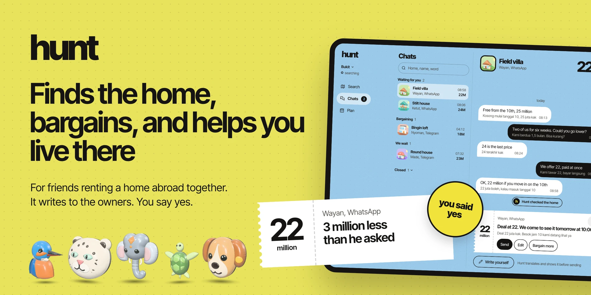</p>

<p align="center"><a href="README.md">English</a> · <b>Русский</b></p>

Снимать дом за границей с друзьями это вторая работа: сорок чатов, три языка, цена зависит от того, кто спросил, а потом кому-то ещё покупать токен на свет.

**Hunt это личный ассистент для этой работы.** Он ищет дома, пишет хозяевам с твоих аккаунтов на их языке, торгуется, планирует просмотры, читает договор. Вы голосуете и говорите «да». После заезда тот же проект ведёт дом: деньги, заказы, афиша, документы.

<p align="center">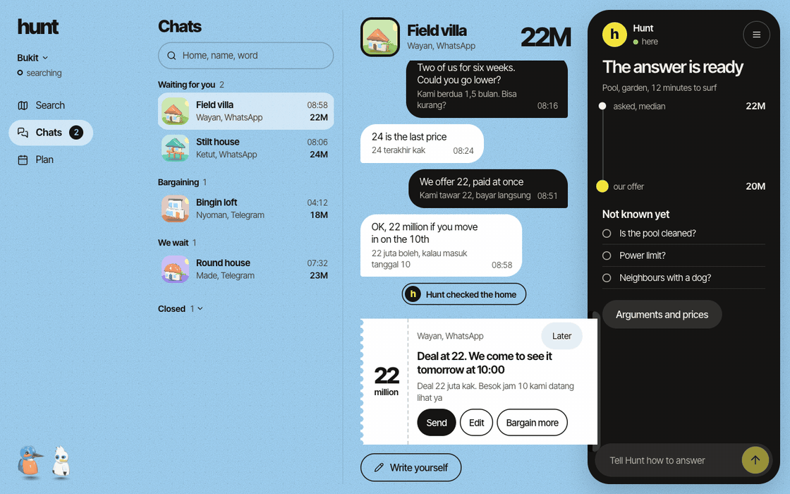</p>

## Что умеет

На картинках два выдуманных проекта: поиск квартиры в Белграде и снятый дом на Бали.

<p align="center">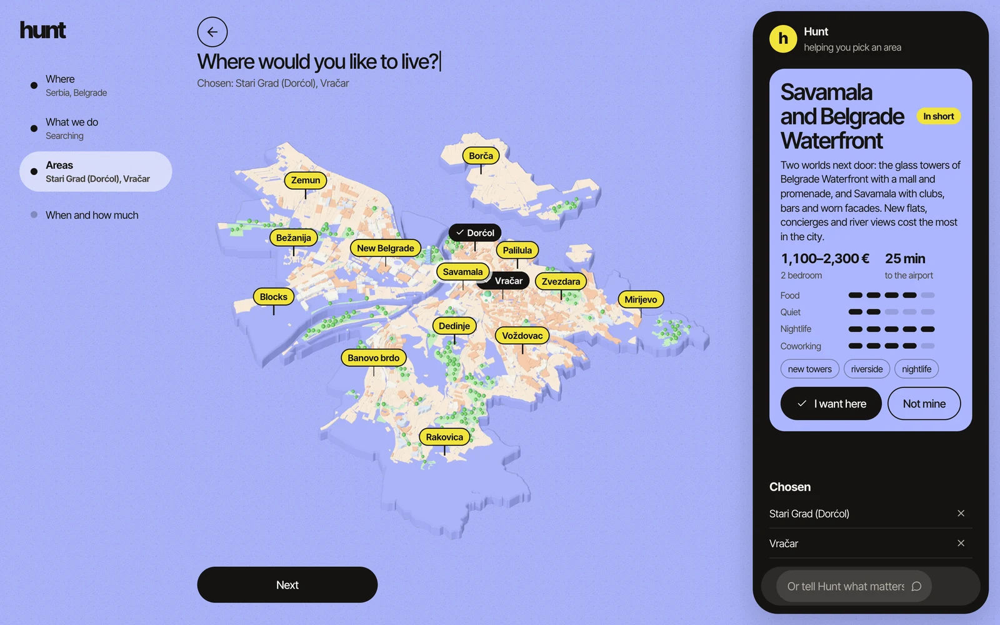</p>

**Начинается с карты.** Выбираешь страну и город, тыкаешь в районы на игрушечной карте. У каждого короткая карточка: район в двух фразах, цена за твоё число спален, минуты до аэропорта, четыре оценки, «Хочу тут» или «Не моё». Потом дата заезда, срок и потолок цены, который видишь только ты. Можно просто написать это Hunt своими словами, разницы нет.

<table>
<tr>
<td width="50%" valign="top">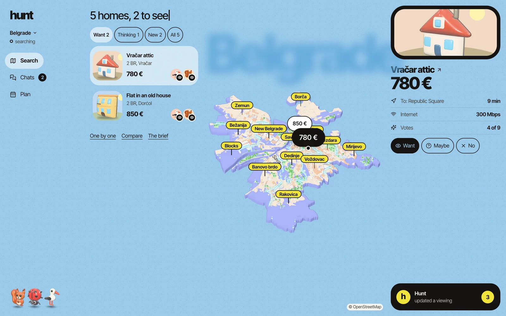<br><b>Ищет.</b> Порталы, чаты и группы, которые ты покажешь, дома булавками на игрушечной карте настоящего города. Проверяет на обман, затопление, дорогу до пляжа. Друзья голосуют.</td>
<td width="50%" valign="top">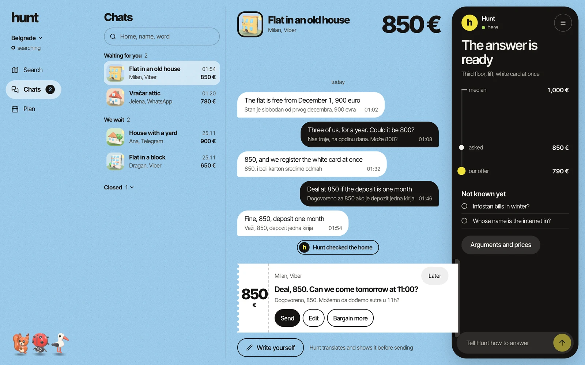<br><b>Пишет и торгуется.</b> Telegram, WhatsApp, Messenger, Instagram, почта, Viber и LINE в одно касание. Сначала твой язык, под ним оригинал. Твой потолок цены никто не видит.</td>
</tr>
<tr>
<td width="50%" valign="top">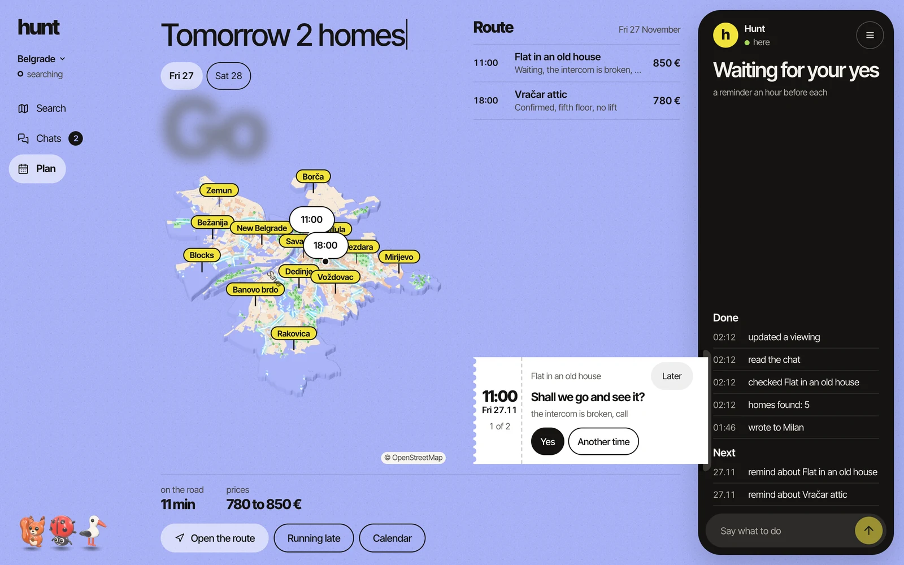<br><b>Планирует.</b> Просмотры одним маршрутом, напоминание перед каждым домом.</td>
<td width="50%" valign="top">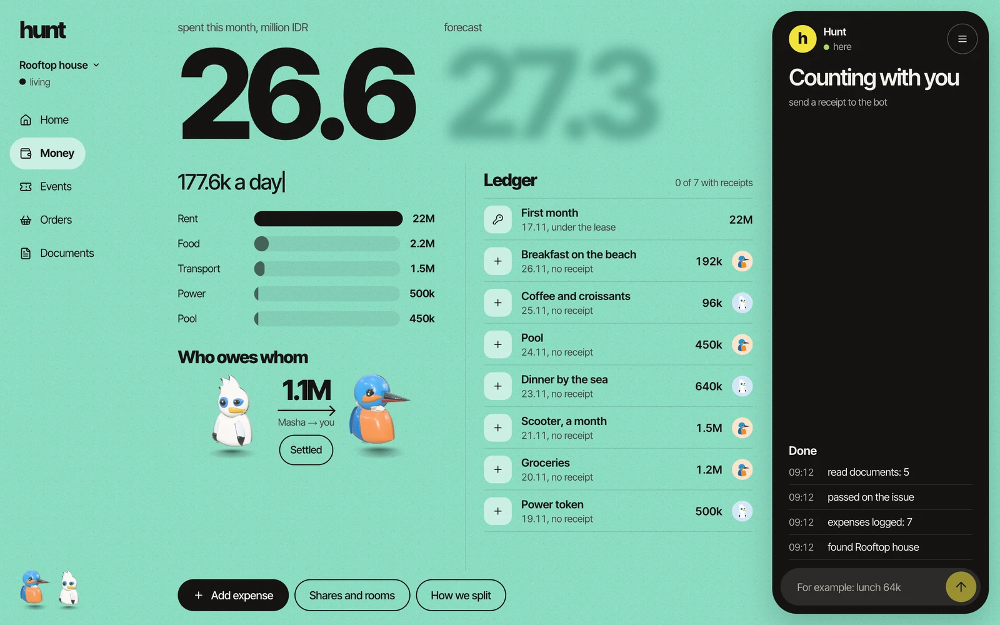<br><b>Считает.</b> Кто платил, кто кому должен, сколько стоит день. Размытая цифра ещё открыта, резкая решена.</td>
</tr>
<tr>
<td width="50%" valign="top">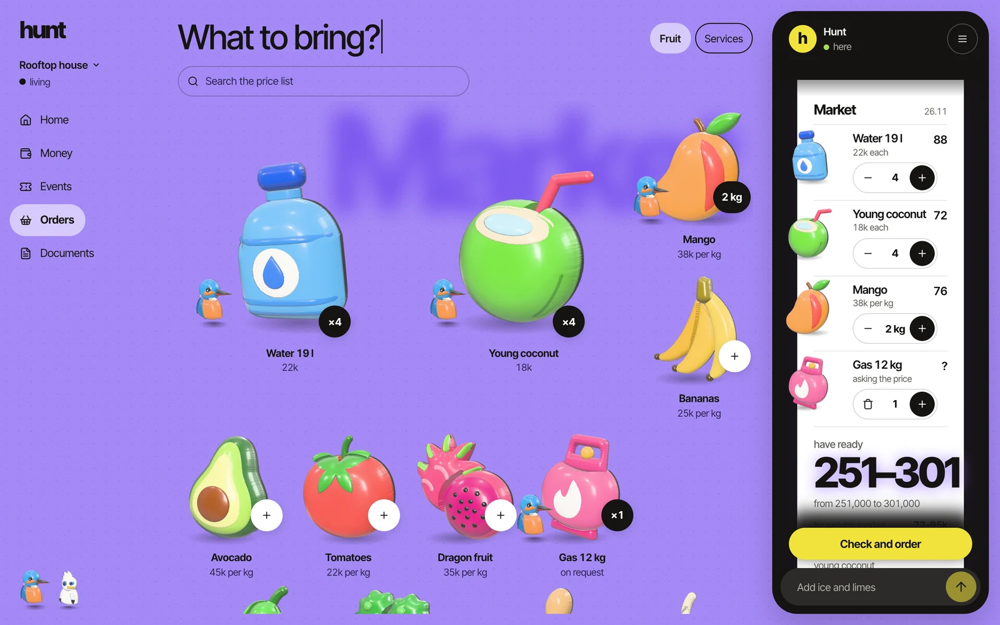<br><b>Заказывает.</b> Вода, фрукты, рыба: прайс превращается в прилавок, чек печатается на глазах.</td>
<td width="50%" valign="top">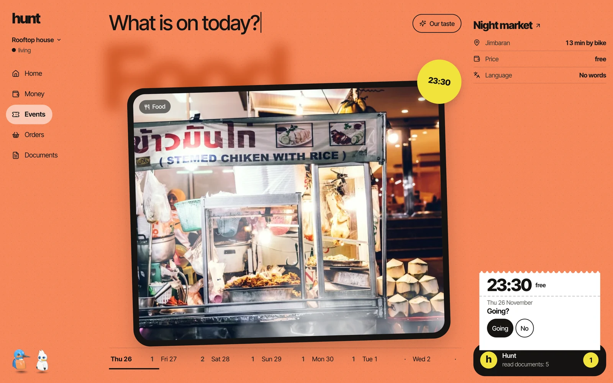<br><b>Знает, куда пойти.</b> События рядом с домом, почему вам подойдёт, и запишет.</td>
</tr>
<tr>
<td width="50%" valign="top">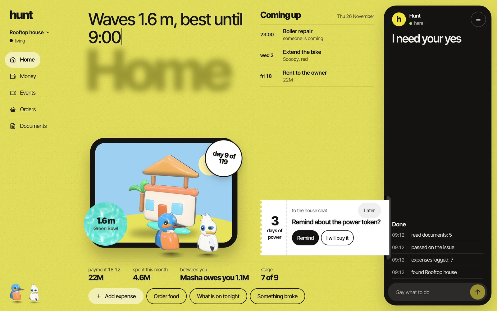<br><b>Собирает всё вместе.</b> Что ближайшее, где нужно твоё «да», какая волна.</td>
<td width="50%" valign="top">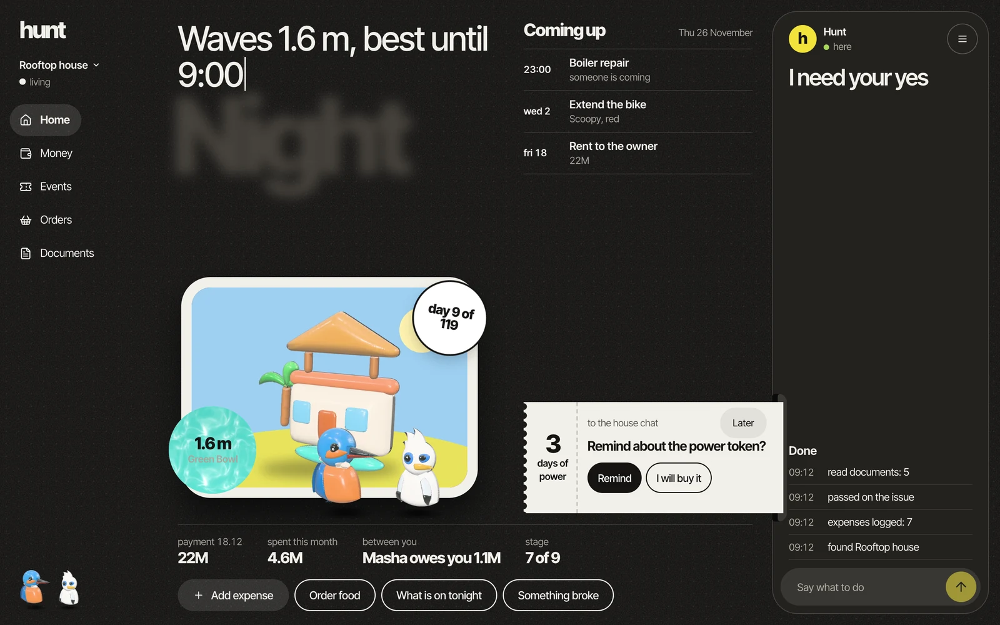<br><b>Следит за домом.</b> Свет, поломки, гости, конец договора. Зовёт, когда нужно твоё «да».</td>
</tr>
</table>

То же самое в телефоне, Telegram Mini App:

<p align="center">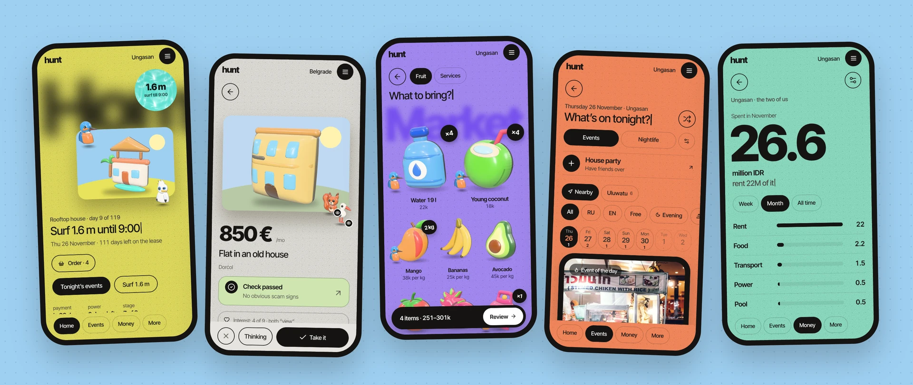</p>

## Как устроено

<p align="center">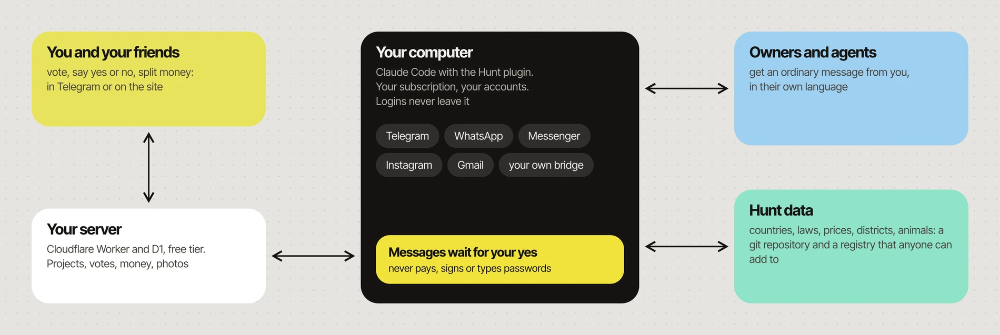</p>

- **Твой агент, твоя подписка, твои аккаунты.** На твоём компьютере работает Claude Code с плагином Hunt. Входы остаются там, у сервера их нет.
- **Решаешь ты.** Сообщение ждёт твоего «да», потом ещё восемь секунд на отмену. Рутину можно разрешить без вопроса. Агент никогда не платит, не подписывает и не вводит пароли и коды.
- **Один сервер на друзей.** У каждого свой агент. Чужие проекты, контакты и переписка не видны.
- **Сайт без паролей.** Сайт показывает число, ты нажимаешь его в боте.

## Попробовать

**Сначала посмотреть.** На любом сервере Hunt есть демо без входа: люди выдуманные, дома игрушечные, ничего не отправляется. Открой `/app` и нажми «Посмотреть демо». У себя:

```bash
git clone https://github.com/LevDomasnih/hunt-app && git clone https://github.com/LevDomasnih/hunt-data
cd hunt-app/crm && npm ci && HUNT_REGIONS=../../hunt-data/regions npm run dev
```

**У друга есть сервер.** Открой приглашение, нажми Start в боте, потом в Claude Code (нужен [uv](https://docs.astral.sh/uv/)):

```
/plugin marketplace add LevDomasnih/hunt-app
/plugin install hunt@hunt
/hunt:new Тбилиси
```

**Свой сервер.** Минут десять на бесплатном Cloudflare: [crm/README.md](crm/README.md).

Команды: `/hunt:new` новый поиск, `/hunt:connect` каналы, `/hunt:sweep` собрать дома, `/hunt:tick` что нового, `/hunt:deal` договор и заезд, `/hunt:region` новая страна или город, `/hunt:share` поделиться, `/hunt:schedule` по расписанию, `/hunt:close` красиво закончить.

## У каждого места своё лицо

Страна это данные: законы с источниками, цены, районы с короткой карточкой, обманы, шаблоны сообщений, главные форумы и гайды на английском, русском и местном языке, и внешний вид. Один яркий цвет и восемь зверей, которые там живут. Каждому другу достаётся зверь.

<p align="center">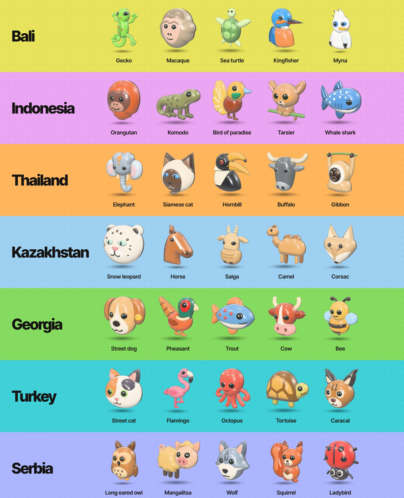</p>

Готовы сейчас:

| Страна | Города |
|---|---|
| Бали | Букит, Чангу, Убуд, Санур |
| Индонезия | Джакарта |
| Таиланд | Бангкок, Пхукет, Паттайя, Чиангмай, Ко Панган |
| Казахстан | Алматы, Астана |
| Грузия | Тбилиси, Батуми |
| Турция | Стамбул, Анталья |
| Сербия | Белград, Нови-Сад |

У больших городов игрушечная карта из OpenStreetMap: кварталы нарезаны настоящими улицами и подняты по их домам, парки с игрушечными деревьями, реки, несколько доминант, жёлтые таблички районов и мягкие светлые стены между ними. Сейчас так у Белграда и Бангкока, остальные следующие.

Навык `hunt-art` учит любого агента рисовать новое место в этом стиле, `citymap.py` собирает город.

**Нет твоего города?** `/hunt:region Лиссабон` соберёт. `/hunt:share pt` предложит всем: бот покажет весь текст, который уйдёт, и без твоего «да» не отправит. Админ проверит, и город появится у всех. Данные живут отдельно от кода: законы, районы и рисунки в [hunt-data](https://github.com/LevDomasnih/hunt-data), чаты и группы в реестре (`registry/`).

## Каналы

Telegram (MTProto, вход по QR, или автоматизация чатов Telegram: Hunt видит только чаты, которые ты открыл, и следит за этим сам Telegram), WhatsApp Web, Messenger и Instagram в своём браузере Hunt, почта через Gmail. Viber и LINE в одно касание: Hunt готовит текст и ссылку, чат открывается в твоём приложении, отправляешь ты. Всё остальное через [мост](plugins/hunt/channels/BRIDGE.md): маленькая локальная служба, менять Hunt не нужно.

> [!WARNING]
> WhatsApp, Messenger и Instagram запрещают автоматизировать личные аккаунты и могут их заблокировать. Подключать или нет, решаешь ты. Лучше отдельный номер и спокойный темп, в группах соблюдай их правила. Telegram ограничивает за спам.

## Приватность

Входы и агент на твоём компьютере. Сервер хранит проекты, голоса, деньги и записанную переписку, номера паспортов и карт не принимает. Что Hunt может читать, видно на экране, а не в обещании: какие чаты открыты, что закрыто, сколько можно тратить на ИИ, и одна кнопка, которая всё забирает и печатает, что закрыла. Тот, кто держит сервер, технически может открыть его базу: бери свой или друга, которому доверяешь. `/privacy` в боте расскажет, что хранится, `/delete` удалит тебя со всеми проектами. Агент думает на твоей подписке: тексты уходят поставщику модели.

## Проверь сам

Правила аренды, въезда и посредничества в странах разные. В Индонезии иностранцам ограничено посредничество в сделках с недвижимостью. Заметки о странах это общая информация с источниками и датами, не юридический совет. Используй Hunt для своего дома, про договор и право сдавать спроси местного специалиста.

## Лицензия

[AGPL-3.0](LICENSE): пользуйся, меняй, делись. Если запускаешь изменённую версию для других, дай им её исходники.

Карты: © участники OpenStreetMap, ODbL. Тайлы: OpenFreeMap. Население для игрушечных городов: Kontur, CC BY 4.0. Прогноз моря: Open-Meteo. Люди и дома на картинках выдуманы.
